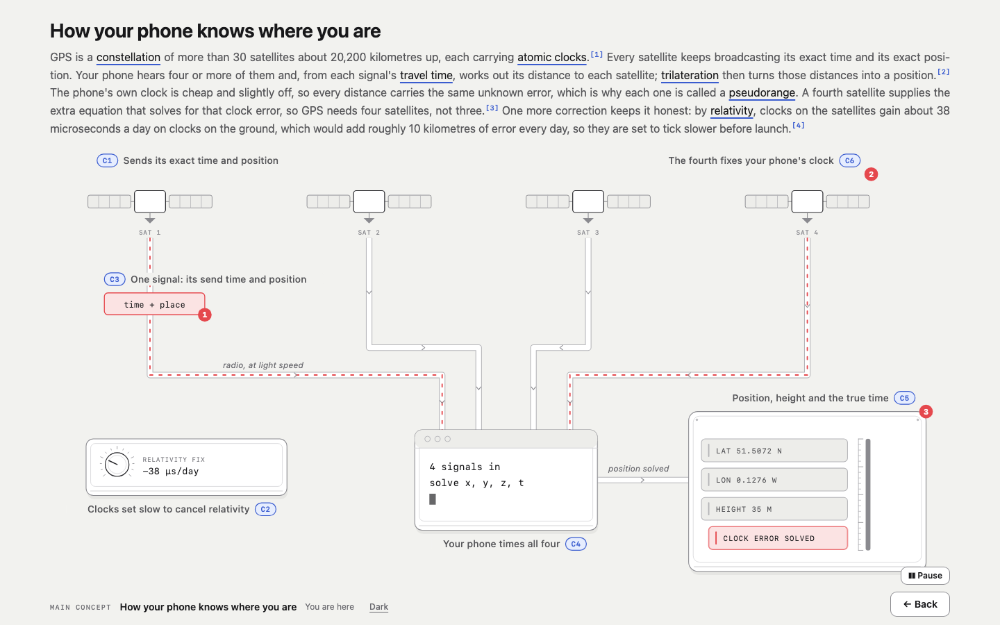
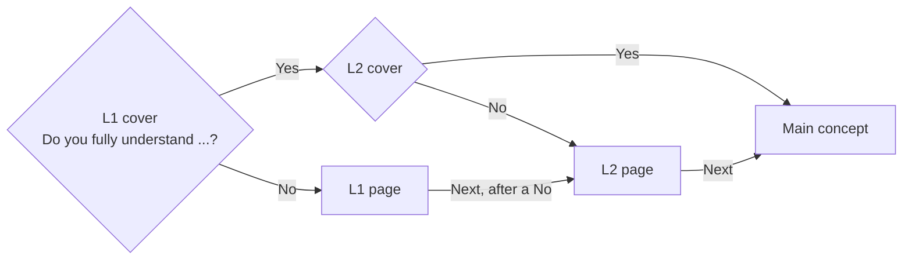
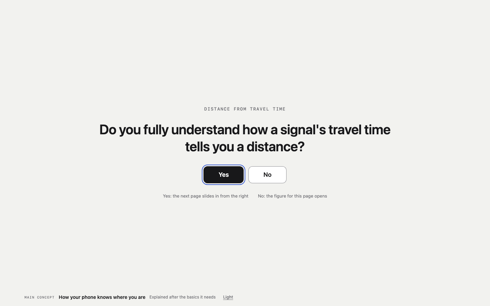
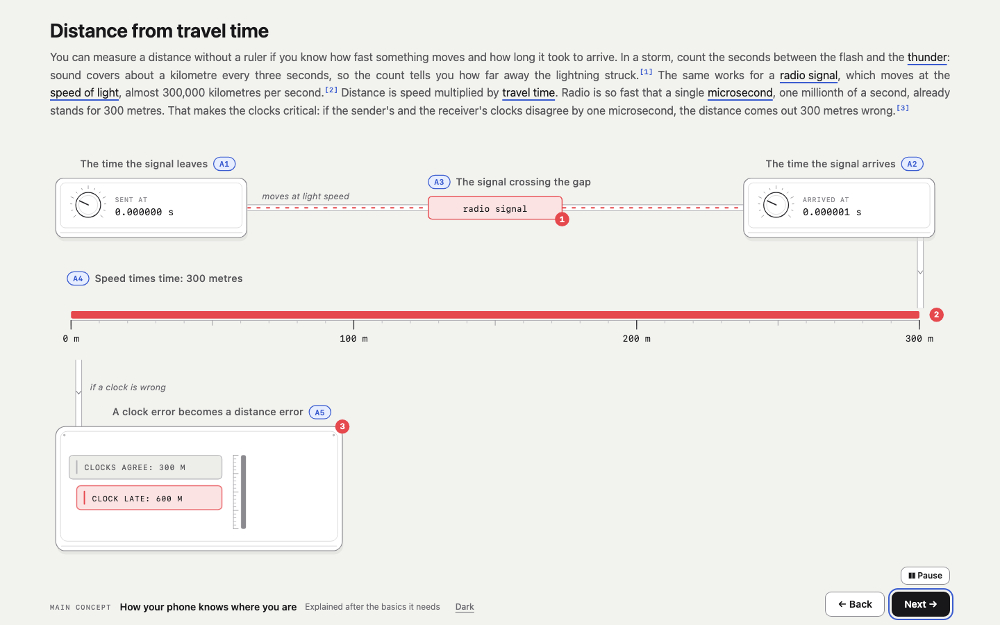
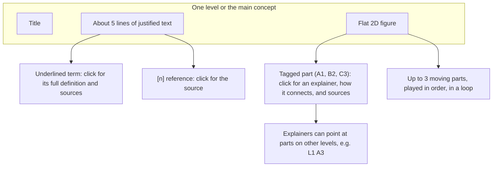
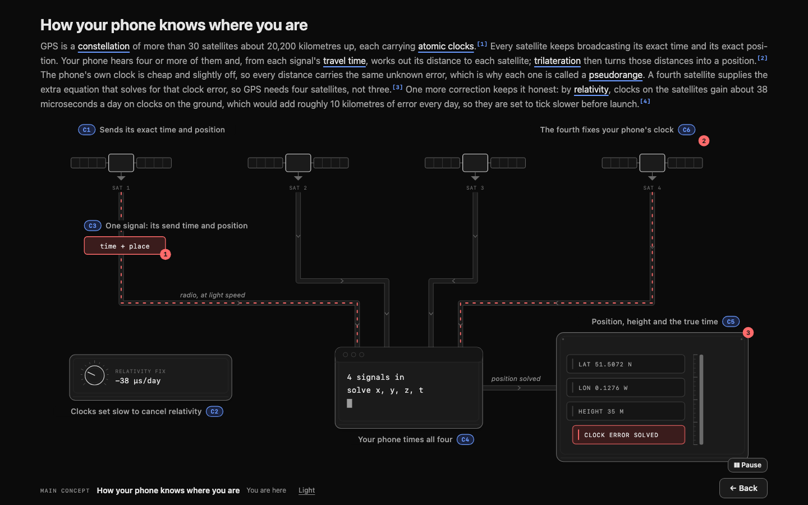
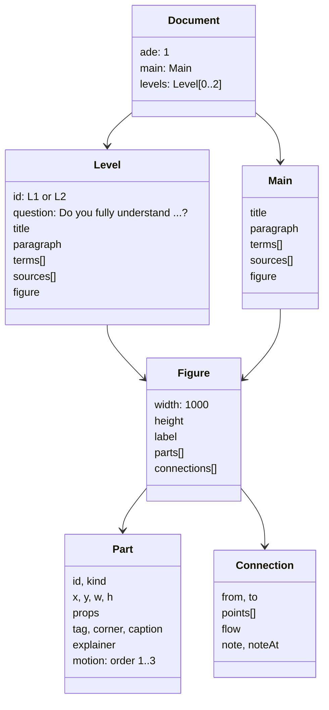
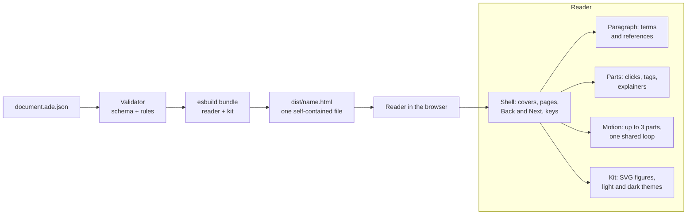
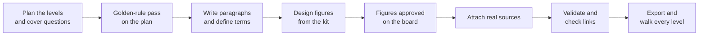

# ADE

**Advance Descriptive Explainer.** A document format and a full-screen browser reader that turn
one hard concept into an interactive, animated, flat 2D illustration, preceded by up to two
prerequisite levels the reader can skip.

ADE is not a summary. All the information is there; it is arranged so a reader at any level gets
to full understanding faster than they would from long text. Every hard word is defined, every
claim has a source, and every part of the figure can be clicked for its own explanation.



## Contents

- [How a reader moves through a document](#how-a-reader-moves-through-a-document)
- [What is on a page](#what-is-on-a-page)
- [Quick start](#quick-start)
- [The document format](#the-document-format)
- [The figure kit](#the-figure-kit)
- [Validation rules](#validation-rules)
- [How it is built](#how-it-is-built)
- [Writing a document with Claude Code](#writing-a-document-with-claude-code)
- [Project layout](#project-layout)
- [How the project is run](#how-the-project-is-run)

## How a reader moves through a document

A document has a **main concept** and up to two **prerequisite levels** (L1, L2), in reading order.
Each level opens on a cover question, "Do you fully understand X?".

- **Yes** skips the level: the next page slides in.
- **No** reveals the level's page (paragraph and figure). After a No, the reader is missing the
  basics the later levels build on, so no further cover questions are asked: Next goes straight
  to each remaining level's page, then to the main concept.



A reader who already knows everything sees two questions and lands on the main concept. A
newcomer answers No once and reads every page in order. Back always returns to the page before.

<table>
  <tr>
    <td></td>
    <td></td>
  </tr>
  <tr>
    <td align="center">A cover question</td>
    <td align="center">L1 revealed: paragraph, terms, references and figure</td>
  </tr>
</table>

## What is on a page



- **Terms** are defined once, on the page that introduces them. A later page can use an earlier
  term; clicking it shows the original definition, labelled with where it came from.
- **References** `[n]` point at real, reputable sources (government, university, standards and
  reference pages). Every source link is checked.
- **Figure parts** that need explaining carry a tag (`A1`, one letter per level) and a 5 to 8 word
  caption. Clicking one opens an explainer: what it is, how it connects to other parts (with
  clickable tags), and its sources.
- **Motion**: at most 3 parts move, in a set order, so the eye follows the mechanism. Each move
  takes about 2.5 s with soft easing and a 1.5 s hold before the next; traveling packets move at a
  steady, readable speed along their path. Motion pauses while a popup is open, has a pause
  button, and starts paused (on the final frame) when the system asks for reduced motion.
- **Light and dark themes** follow the system setting and can be switched in the footer. Both
  meet WCAG AA contrast.



## Quick start

Requires Node.js 22 or later.

```bash
npm install
```

Export the GPS reference document to a single, self-contained HTML file:

```bash
npm run export -- docs/gps.ade.json
```

Then open `dist/gps.html` in a browser. The file has no external requests, so it can be shared as
is (email, chat, a static host).

Other commands:

```bash
npm run validate -- docs/gps.ade.json
```

```bash
npm run check-links -- docs/gps.ade.json
```

```bash
npm test
```

```bash
npm run typecheck
```

| Command | What it does |
|---|---|
| `npm run validate -- <file>` | Checks a document against the schema and every rule below |
| `npm run check-links -- <file>` | Requests every source URL and reports the ones that do not resolve |
| `npm run export -- <file>` | Validates, then bundles the reader and the document into `dist/<name>.html` |
| `npm test` | Runs the test suite (format, kit, reader, themes, export) |
| `npm run typecheck` | Type-checks the project with `tsc` |

## The document format

A document is one JSON file (`*.ade.json`) described by [schema/ade.schema.json](schema/ade.schema.json).



A paragraph marks a defined term with braces and a reference with brackets:

```json
{
  "paragraph": "Radio moves at the {speed of light}, almost 300,000 kilometres per second.[2]",
  "terms": [
    {
      "term": "speed of light",
      "definition": "The speed at which light and radio waves travel through empty space: exactly 299,792,458 metres per second.",
      "part": "A3",
      "sources": [2]
    }
  ]
}
```

Figures are laid out on a grid 1000 units wide. A part sits exactly where the document places it;
the kit never moves parts. A complete example is [docs/gps.ade.json](docs/gps.ade.json), and a
second one is [test/fixtures/ai-coding-agent.ade.json](test/fixtures/ai-coding-agent.ade.json).

## The figure kit

Figures are drawn by [src/kit/render.ts](src/kit/render.ts) from the document data as flat 2D,
front-view, monochrome SVG. Red is reserved for moving parts. Colours are CSS variables, so one SVG
serves both themes.

| Kind | Draws |
|---|---|
| `panel` | A plain body, optionally with an engraved plate label |
| `tape` | A row of token chips with a dashed slot for the next one |
| `layers` | A stack of model layers with faint links between them |
| `callout` | Only a tag and caption over another part |
| `bars` | Horizontal bars with values from 0 to 1 |
| `dial` | A knob with a scale, a label and a value |
| `chip` | A small packet of text that travels along its connection |
| `terminal` | A terminal window with typed lines |
| `list` | A column of labelled slots (or a tool rack with switches) |
| `ring` | A circle of known distance around a reference point |
| `ruler` | A measuring scale with the measured span drawn from the left |
| `satellite` | A satellite body with two solar wings |
| `files` | A grid of file icons with an optional test lamp |

Props for each kind are listed in [.claude/skills/ade-author/reference/kinds.md](.claude/skills/ade-author/reference/kinds.md).

Spacing rules the kit applies to every figure:

- A tagged part's tag and caption sit on their own label row outside the part, 8 units clear of its
  border, with the tag inset 12 units from the corner. The row never covers the part's content.
- A caption gets a background matching what it sits on, so lines never show through text.
- Content (list slots, terminal lines, chip text) keeps at least 12 units of padding inside its
  part; the validator fails a part whose content would overflow.

## Validation rules

[src/format/validate.ts](src/format/validate.ts) runs the JSON Schema checks, then the rules the
schema cannot express:

| Area | Rule |
|---|---|
| Levels | At most 2 prerequisites, in order (L1 then L2); the cover question reads "Do you fully understand ...?" |
| Terms | Every `{term}` has a definition with at least one source, on this page or an earlier one |
| References | Every `[n]` points at a source on the page |
| Tags | Unique per level; every tag an explainer cites exists, on this level or the one named (`L1 A3`) |
| Captions | 5 to 8 words; connection notes at most 5 words |
| Motion | At most 3 moving parts, with unique orders 1 to 3 |
| Layout | Parts stay inside the figure; content fits inside its part with padding |
| No overlap | A term is defined on one page only; no sentence of 6 or more words appears on two pages; no two pages share the same figure |

The last rule is the format's golden rule: **each page holds information no other page holds**. If
a page only repeats another, it should not exist.

## How it is built



- **TypeScript**, run directly with Node's `--experimental-strip-types` (no build step for tools
  and tests).
- **esbuild** bundles the reader into one HTML file with the document embedded; the reader
  validates the document again on load.
- **Web Animations API** for motion, on one shared loop per figure.
- No runtime dependencies. Dev dependencies: `typescript`, `esbuild`, `@types/node`.

Keyboard: `Y` and `N` answer a cover, arrow keys or `Enter` go Back and Next, `Tab` walks the
figure's tags in order, `Esc` closes a popup.

## Writing a document with Claude Code

The project ships a Claude Code skill, [ade-author](.claude/skills/ade-author/SKILL.md), that
writes a document from a concept:



In Claude Code, ask for an ADE document on a topic, for example "make an ADE document explaining
how vaccines train the immune system". The skill drafts the levels, draws the figures for
approval, sources every claim, and hands over the `.ade.json` and the exported HTML.

## Project layout

```
schema/ade.schema.json        The document format (JSON Schema)
src/format/                   Types and the validator
src/kit/                      Figure kit (SVG renderer) and themes
src/reader/                   The reader: shell, paragraph, parts, popups, motion, styles
bin/                          CLI: validate, export, check-links, kit-preview
docs/gps.ade.json             Reference document: how your phone knows where you are (GPS)
docs/images/                  Screenshots used in this README
test/                         Tests and the AI coding agent example document
design/                       Design proofs and figure previews
.claude/skills/ade-author/    The authoring skill and the kit reference
.spill/                       The project's spec board (specs, questions, decisions)
```

## How the project is run

Every feature is specified before it is built. Specs, questions and decisions live on a
[Spill](.spill/SPILL.md) board in `.spill/`: a spec is drafted, discussed, approved, queued for
build, built with recorded checks, and marked done. UI changes are drawn on the board and approved
before they are written into the code or a document.

The visual style of the figures takes its foundation from
[wheresryan22/anatomy](https://github.com/wheresryan22/anatomy).
